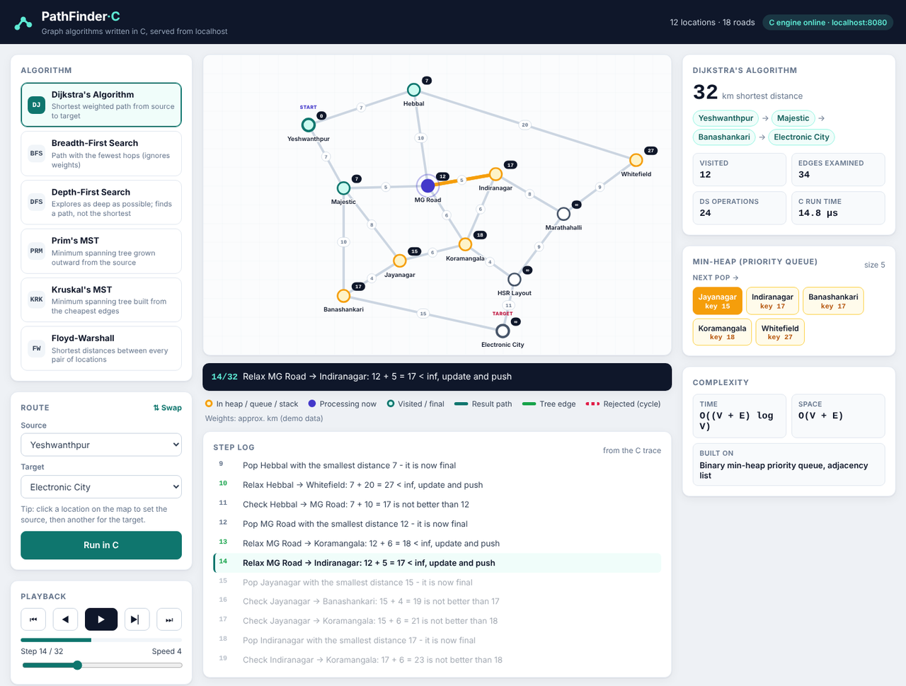
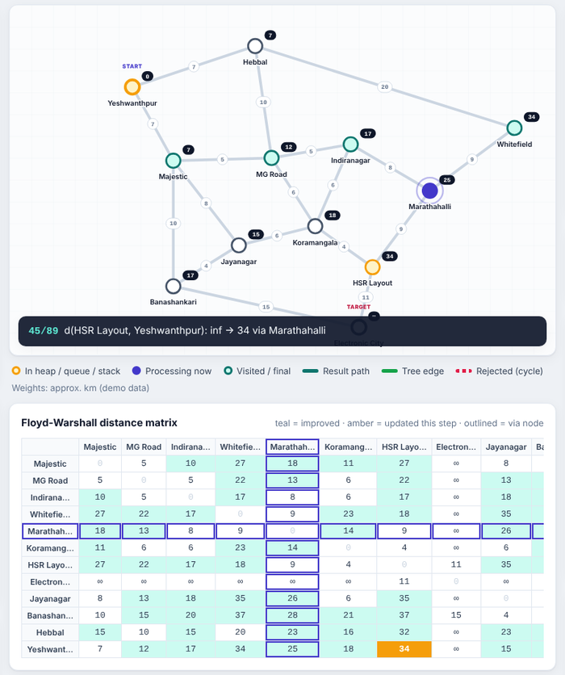

# PathFinder-C · Graph Algorithms Visualizer in C

A localhost web app that finds routes on a city map using classic **graph algorithms written in C**.
A small HTTP server, also written in plain C with no external libraries, runs the algorithms and
streams a step-by-step trace to the browser. The browser animates every heap push, queue pop and
edge relaxation as it happens.



## Features

- **Six graph algorithms in C**: Dijkstra, Breadth-First Search, Depth-First Search, Prim's MST,
  Kruskal's MST and Floyd-Warshall.
- **Step-by-step replay** of the trace recorded by C, with play/pause, step forward/back and speed control.
- **Live data-structure view**: the min-heap, queue, stack or union-find sets at every step.
- **Live Floyd-Warshall matrix** that fills in as each intermediate node is allowed.
- **Graph editor**: add, move or delete locations and roads on the map. Changes are saved by the C server.
- **Import / export** the graph as a plain-text file.
- **Terminal mode**: run any algorithm without the browser.
- **Unit tests in C**: 900 checks that cross-verify the algorithms against each other.



## DSA concepts used

| Concept | Where | Used by | Complexity |
|---|---|---|---|
| Graph as an **adjacency list** (linked lists) | `src/graph.c` | everything | O(V + E) space |
| **Binary min-heap** priority queue | `src/ds.c` | Dijkstra, Prim | O(log n) push / pop |
| **Circular queue** (array) | `src/ds.c` | BFS | O(1) enqueue / dequeue |
| **Stack** (dynamic array) | `src/ds.c` | DFS | O(1) push / pop |
| **Union-Find** (path compression + union by rank) | `src/ds.c` | Kruskal | ≈ O(1) amortised |
| **Merge sort** on edges | `src/ds.c` | Kruskal | O(E log E) |
| **2-D DP matrix** | `src/algorithms.c` | Floyd-Warshall | O(V³) time, O(V²) space |

| Algorithm | Solves | Time |
|---|---|---|
| Dijkstra | Shortest weighted path | O((V + E) log V) |
| BFS | Path with the fewest hops | O(V + E) |
| DFS | Depth-first traversal, any path | O(V + E) |
| Prim | Minimum spanning tree (grows from a source) | O(E log V) |
| Kruskal | Minimum spanning tree (cheapest edges first) | O(E log E) |
| Floyd-Warshall | All-pairs shortest paths | O(V³) |

## How it works

```
 Browser (HTML/CSS/JS)                      C program (pathfinder)
 ─────────────────────                      ──────────────────────
 draws the map, plays the   ── HTTP ──▶     server.c   sockets, routing, static files
 animation, edits the graph  ◀── JSON ──    graph.c    adjacency list + save/load
                                            ds.c       heap, queue, stack, union-find, merge sort
                                            algorithms.c  the six algorithms + step trace
```

Every algorithm records a `Step` (type, nodes, value, message, and a snapshot of its data
structure) into a trace. The server returns the answer and the trace as JSON, and the page
replays it. **No algorithm logic runs in JavaScript.**

## Build and run

You need a C compiler (`gcc` or `clang`). There are no other dependencies.

**Linux / macOS**

```bash
make            # builds ./pathfinder
./pathfinder    # then open http://localhost:8080
```

**Windows** (MinGW-w64 gcc, e.g. from MSYS2 or WinLibs, on your PATH)

```bat
build.bat
pathfinder.exe
```

**Dev-C++** (Windows): open `PathFinder.dev` and press **F11** (Compile & Run).
If your Dev-C++ version doesn't accept the project file, create a **C** (not C++) console project
in the project folder, add the six `.c` files in `src/`, and put `-lws2_32 -lshell32` in
Project → Project Options → Parameters → Linker.

The program opens <http://localhost:8080> in your default browser (Chrome, Edge, Firefox…)
by itself. Keep its window open while you use the app; closing it stops the server.
Use `--no-browser` to skip opening the browser, or `./pathfinder 9000` for another port.

> **Why not just open `public/index.html`?** The page is only the front end. Every algorithm runs
> inside the C program, so the page needs `pathfinder` running and must be opened through
> `http://localhost:8080`. Opened as a `file:///` page, it shows "C engine offline".

## Terminal mode

```bash
./pathfinder --list                  # locations and their ids
./pathfinder --run dijkstra 11 7     # Yeshwanthpur -> Electronic City
./pathfinder --run kruskal 0         # minimum spanning tree
```

Algorithm keys: `dijkstra`, `bfs`, `dfs`, `prim`, `kruskal`, `floyd`.

## Tests

```bash
make test
```

The tests check the heap, queue, stack, union-find and merge sort, plus graph editing and
save/load. For all 144 source/target pairs on the demo map they also check that:

- Dijkstra's distance equals Floyd-Warshall's;
- BFS hop counts equal Floyd-Warshall on a unit-weight copy of the graph;
- every returned path is made of real roads;
- Prim from every start gives the same MST weight as Kruskal.

## Project structure

```
src/
  main.c          entry point, terminal mode
  server.c/.h     HTTP server and JSON API (POSIX sockets / Winsock)
  graph.c/.h      adjacency-list graph, text persistence, JSON
  ds.c/.h         min-heap, circular queue, stack, union-find, merge sort
  algorithms.c/.h six algorithms with step tracing
  strbuf.c/.h     growable string buffer for JSON
public/           index.html, style.css, app.js (UI only)
data/             default_graph.txt (demo map); graph.txt is created at runtime
tests/            test_algorithms.c
docs/             screenshots
```

## HTTP API

| Method | Endpoint | Purpose |
|---|---|---|
| GET | `/api/graph` | Current graph (nodes, edges) |
| GET | `/api/algorithms` | Algorithm list with complexities |
| GET | `/api/run?algo=dijkstra&src=11&dst=7` | Run an algorithm; returns result + trace |
| POST | `/api/node/add?name=&x=&y=` | Add a location |
| POST | `/api/node/move?id=&x=&y=` | Move a location |
| POST | `/api/node/remove?id=` | Delete a location and its roads |
| POST | `/api/edge/add?u=&v=&w=` | Add or update a road |
| POST | `/api/edge/remove?u=&v=` | Delete a road |
| POST | `/api/reset` / `/api/clear` | Restore the demo map / empty the graph |
| GET / POST | `/api/export` / `/api/import` | Download / upload the graph text file |

## Graph file format

```
N <id> <x> <y> <name>     # a location (x: 0-1000, y: 0-640 on the map)
E <u> <v> <weight>        # an undirected road, weight 1-9999
```

## Notes

- The demo map uses 12 Bengaluru localities. The distances are **approximate and simplified**
  for teaching; they are not real navigation data.
- The server listens on `127.0.0.1` only, so it is not reachable from other machines.
- Limits: 64 locations, weights 1-9999.
